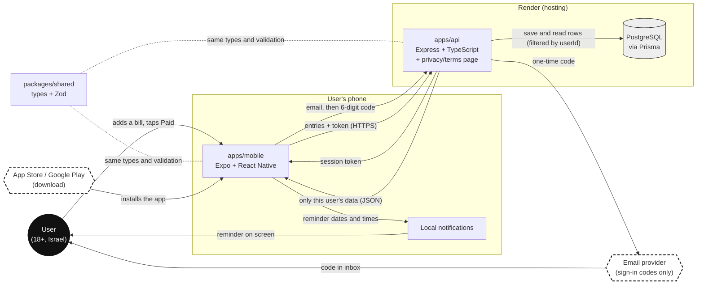
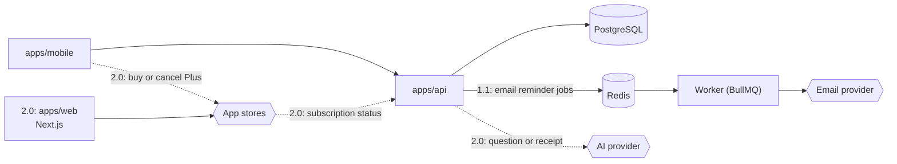

# Money Memory: architecture

## Version 1.0 (what we build now)

**Legend:** circle = user; rectangle = our code; cylinder = data; dashed hexagon = external service.

- **apps/mobile:** every screen, the language picker, and scheduling reminders on the phone.
- **Local notifications:** reminders fire on time even with no internet.
- **apps/api:** checks who you are, returns only your data, saves entries, serves the privacy and terms page.
- **PostgreSQL + Prisma:** stores users, consents, obligations and transactions (`docs/db-schema.md`).
- **packages/shared:** one definition of "bill" and its validation, used by app and server so they never drift.
- **Email provider:** sends the sign-in code, nothing else.
- **Render:** runs the api and the database.

## Target (versions 1.1 and 2.0, not now)

## Security rules that come from this design
- The api is the only door to the database; the app never talks to the database directly.
- Every query filters by the signed-in `userId`; every endpoint has a cross-user test (D23).
- Codes and session tokens are stored hashed; no passwords exist (D34).
