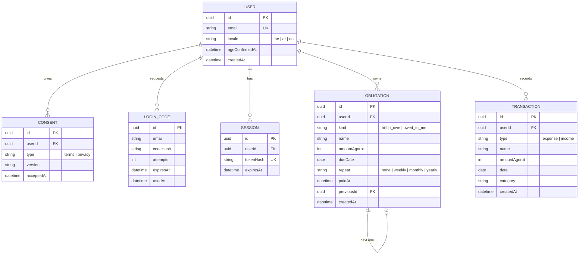

# Money Memory: database schema (version 1.0)

PostgreSQL + Prisma. Only what version 1.0 needs. Budgets, goals, subscriptions screen, AI and billing tables come later.



## Prisma schema

The real file is `apps/api/prisma/schema.prisma`; extra SQL that Prisma cannot express is in `apps/api/prisma/migrations-extra/`. The copy below is for reading.

```prisma
generator client {
  provider = "prisma-client-js"
}

datasource db {
  provider = "postgresql"
  url      = env("DATABASE_URL")
}

enum Locale { he ar en }
enum ConsentType { terms privacy }
enum ObligationKind { bill i_owe owed_to_me }
enum Repeat { none weekly monthly yearly }
enum TransactionType { expense income }
enum Category { groceries transport eating_out health housing fun other }

model User {
  id             String        @id @default(uuid())
  email          String        @unique
  locale         Locale        @default(he)
  ageConfirmedAt DateTime
  createdAt      DateTime      @default(now())
  consents       Consent[]
  sessions       Session[]
  obligations    Obligation[]
  transactions   Transaction[]
}

model Consent {
  id         String      @id @default(uuid())
  userId     String
  user       User        @relation(fields: [userId], references: [id], onDelete: Cascade)
  type       ConsentType
  version    String
  acceptedAt DateTime    @default(now())
  @@index([userId])
}

model LoginCode {
  id        String    @id @default(uuid())
  email     String
  codeHash  String
  attempts  Int       @default(0)
  expiresAt DateTime
  usedAt    DateTime?
  createdAt DateTime  @default(now())
  @@index([email])
}

model Session {
  id        String   @id @default(uuid())
  userId    String
  user      User     @relation(fields: [userId], references: [id], onDelete: Cascade)
  tokenHash String   @unique
  expiresAt DateTime
  createdAt DateTime @default(now())
  @@index([userId])
}

model Obligation {
  id           String         @id @default(uuid())
  userId       String
  user         User           @relation(fields: [userId], references: [id], onDelete: Cascade)
  kind         ObligationKind
  name         String
  amountAgorot Int
  dueDate      DateTime       @db.Date
  repeat       Repeat         @default(none)
  paidAt       DateTime?
  previousId   String?        @unique
  previous     Obligation?    @relation("Series", fields: [previousId], references: [id], onDelete: SetNull)
  next         Obligation?    @relation("Series")
  createdAt    DateTime       @default(now())
  updatedAt    DateTime       @updatedAt
  @@index([userId, dueDate])
}

model Transaction {
  id           String          @id @default(uuid())
  userId       String
  user         User            @relation(fields: [userId], references: [id], onDelete: Cascade)
  type         TransactionType
  name         String
  amountAgorot Int
  date         DateTime        @db.Date
  category     Category        @default(other)
  createdAt    DateTime        @default(now())
  updatedAt    DateTime        @updatedAt
  @@index([userId, date])
}
```

## Notes
- **Primary metric (D31):** "missed" = an `Obligation` of kind `bill` with `dueDate` in the past and `paidAt` null. Computed from these rows; no event table in 1.0.
- `previousId @unique` makes "a paid bill creates exactly one next bill" a database rule, not just code.
- `onDelete: Cascade` on every user relation makes account deletion (task 9) remove all rows.
- Category labels are translation keys (`category.groceries`), not stored text.
- Subscriptions in 1.0 are entered as repeating bills; a dedicated subscriptions screen is 1.1.
